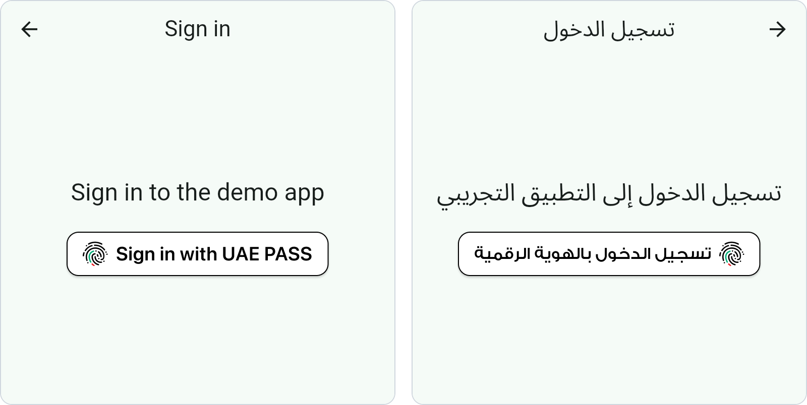

# UAE PASS for Flutter

An independently maintained Flutter plugin for UAE PASS sign-in and PDF signing approval on Android, iOS, and Flutter Web, with the official English and Arabic buttons.

The app starts UAE PASS authorization and receives a one-time code. Your backend exchanges that code, applies your account rules, and returns an app session. For signing, your backend starts the request and verifies the signed PDF, and the app opens the UAE PASS approval.



```dart
import 'package:flutter/widgets.dart';
import 'package:uaepass/uaepass.dart';

final client = UaePassClient(
  UaePassConfiguration(
    environment: UaePassEnvironment.staging,
    clientId: 'your-client-id',
    callbackScheme: 'com.example.yourapp',
    redirectUri: Uri.parse('https://service.example/uaepass/callback'),
  ),
);

Widget buildSignInButton() => UaePassSignInButton(
  client: client,
  onResult: (result) {
    // Send a UaePassSuccess grant's code to your backend.
  },
);
```

[Android and iOS sign-in](#android-and-ios-quick-start) · [Web sign-in](#flutter-web-quick-start) · [Sign a PDF](#document-signing) · [Button options](#button-options)

## Requirements

- Flutter 3.50.1+ and Dart 3.14+
- Android API 24+, iOS 15+, or a Flutter Web app
- A UAE PASS client ID and a registered redirect URI for your environment and channel. [UAE PASS mobile guide](https://docs.uaepass.ae/feature-guides/authentication/mobile-application) · [UAE PASS web guide](https://docs.uaepass.ae/feature-guides/authentication/web-application)

Set `environment` to `UaePassEnvironment.staging` for testing or `UaePassEnvironment.production` for live use. Use the same UAE PASS environment for sign-in, signing, and your backend. Keep the client secret and provider access tokens on your backend.

## Android and iOS quick start

Follow these steps for Android and iOS. The SDK hands off to the UAE PASS app when installed and uses an embedded browser otherwise. For a browser app, see [Flutter Web quick start](#flutter-web-quick-start).

### 1. Install

```sh
flutter pub add uaepass
```

### 2. Register the callback

- `redirectUri` is the final HTTPS OAuth URL registered with UAE PASS. The mobile SDK intercepts it in the WebView to read and validate the authorization result.
- `callbackScheme` is the custom URL scheme used to reopen your app during the UAE PASS app handoff. Choose a unique lowercase reverse-domain name based on your app ID. Register it in the platform settings below and pass the same string, such as `com.example.yourapp`, to `UaePassConfiguration`. Share it with UAE PASS as required by your integration.

#### Android

Merge these entries into the activity that hosts Flutter in your app's `AndroidManifest.xml`. Keep the activity exported for external callbacks. Configure it to deliver the callback to the existing activity via `onNewIntent` so the SDK can resume the same WebView. The example uses `android:launchMode="singleTask"`.

```xml
<meta-data android:name="flutter_deeplinking_enabled" android:value="false" />
<intent-filter>
    <action android:name="android.intent.action.VIEW" />
    <category android:name="android.intent.category.DEFAULT" />
    <category android:name="android.intent.category.BROWSABLE" />
    <data android:scheme="com.example.yourapp" />
    <data android:host="success" />
    <data android:host="failure" />
</intent-filter>
```

The plugin declares internet access and both UAE PASS packages in its Android manifest.

#### iOS

Merge these keys and array entries into your app's `Info.plist`. The URL type registers your app's callback. The query schemes allow the SDK to check for the production and staging UAE PASS apps. The plugin supports Swift Package Manager and CocoaPods.

```xml
<key>FlutterDeepLinkingEnabled</key>
<false/>
<key>CFBundleURLTypes</key>
<array>
    <dict>
        <key>CFBundleURLSchemes</key>
        <array>
            <string>com.example.yourapp</string>
        </array>
    </dict>
</array>
<key>LSApplicationQueriesSchemes</key>
<array>
    <string>uaepass</string>
    <string>uaepassstg</string>
</array>
```

These platform settings let the SDK receive the custom-scheme return and resume the active WebView. Your sign-in screen gets the result from the button's `onResult` callback.

- The deep-link opt-out turns off Flutter's default deep-link routing for the whole app.
- If you also use app links or universal links, route those URLs with your app's own link handler. [Flutter deep-link setup](https://docs.flutter.dev/ui/navigation/deep-linking#migrating-from-plugin-based-deep-linking)

### 3. Add the button and handle the result

Create one client for your integration and place `UaePassSignInButton` on your sign-in page. The button disables itself during UAE PASS authorization. Its `onResult` callback receives a typed grant, cancellation, or authorization failure.

```dart
import 'package:flutter/widgets.dart';
import 'package:uaepass/uaepass.dart';

final client = UaePassClient(
  UaePassConfiguration(
    environment: UaePassEnvironment.staging,
    clientId: 'your-client-id',
    callbackScheme: 'com.example.yourapp',
    redirectUri: Uri.parse('https://service.example/uaepass/callback'),
  ),
);

class SignInPage extends StatelessWidget {
  const SignInPage({super.key});

  @override
  Widget build(BuildContext context) {
    return UaePassSignInButton(
      client: client,
      onResult: handleAuthorizationResult,
    );
  }
}

// completeSignInOnBackend and showSignInFailure are your app's functions.
Future<void> handleAuthorizationResult(
  UaePassResult<UaePassAuthorizationGrant> result,
) async {
  switch (result) {
    case UaePassSuccess(:final value):
      await completeSignInOnBackend(value.code);
    case UaePassCancelled():
      return;
    case UaePassFailure(:final reason):
      showSignInFailure(reason);
  }
}
```

### 4. Complete sign-in on your backend

Implement `completeSignInOnBackend` by sending the one-time code over HTTPS to an endpoint on your own backend. The backend can use any language or framework that can call the UAE PASS APIs.

1. Exchange the code promptly at UAE PASS `/idshub/token`. Use the client secret stored on your server and the exact registered redirect URI used to start authorization.
2. Fetch the UAE PASS profile at `/idshub/userinfo` from the backend. Apply your approved account eligibility rules and use the stored UAE PASS `uuid` to look up a linked account. Keep `uuid` and `sub` as separate fields. Apply your approved first-time account flow when there is no match.
3. Return an app session on success, or a result the app can present or route. Use `UaePassSignInMessages.forResult` to display supported eligibility and sign-in errors in the app's locale. The app owns loading and navigation during this step.

When the user signs out:

- Invalidate your app session and clear its local credentials.
- Call `await client.logout(context)` to end the UAE PASS session in the embedded browser. It returns `true` when UAE PASS returns to the configured redirect URI.
- For your UAE PASS assessment, verify that the next sign-in challenges the user again through both the UAE PASS app and the embedded browser.

[UAE PASS logout guide](https://docs.uaepass.ae/feature-guides/authentication/web-application/4.-web-single-sign-on-sso-and-logout-user-session-from-uae-pass) · [Authentication checklist](https://docs.uaepass.ae/getting-onboarded-with-uae-pass/onboarding-process-for-uae-pass-service-providers/development-phase#assessment-check-list)

## Flutter Web quick start

Install `uaepass` with `flutter pub add uaepass`, then set up the callback:

- Register a callback on the same origin as your Flutter Web app. Use HTTPS for hosted apps. Web staging can use HTTP at `localhost`.
- Serve the Flutter entry document at the callback path, and process the callback before your router or analytics initialize. [Flutter URL strategies](https://docs.flutter.dev/ui/navigation/url-strategies)
- Set `Referrer-Policy: no-referrer` on the callback response, and keep its query string out of access logs and traces.
- Use the exact registered redirect URI in the app and backend configuration.
- Use the web channel's credentials. UAE PASS issues separate credentials for the approved web channel. [UAE PASS onboarding guidelines](https://docs.uaepass.ae/guidelines/use-cases/standard-implementation-guidelines)

```dart
import 'package:flutter/widgets.dart';
import 'package:uaepass/uaepass.dart';

final webClient = UaePassWebClient(
  UaePassWebConfiguration(
    environment: UaePassEnvironment.staging,
    clientId: 'your-web-client-id',
    redirectUri: Uri.parse('https://service.example/uaepass/callback'),
  ),
);

void main() {
  WidgetsFlutterBinding.ensureInitialized();
  final signIn = webClient.completeLogin(exchangeCode: exchangeCode);
  runApp(
    MyApp(
      initialSignIn: signIn,
      signInButton: UaePassWebSignInButton(
        client: webClient,
        onStart: (result) {
          if (result case UaePassFailure(:final reason)) {
            showSignInFailure(reason);
          }
        },
      ),
    ),
  );
}
```

Implement `UaePassCodeExchange<T>` as `exchangeCode` to send the grant to your backend and return a typed session result. Use a browser-accessible endpoint, follow the same server exchange steps, and protect session creation against cross-site requests. See [Complete sign-in on your backend](#4-complete-sign-in-on-your-backend).

Use your app's `showSignInFailure` handler to display errors when the browser cannot start authorization.

The SDK stores one-time authorization state in the current tab, validates and consumes it after the redirect, and removes the provider parameters from the URL before calling `exchangeCode`. The future resolves to `null` on a regular page load. Use `completeAuthorization()` instead when your app handles the grant directly. UAE PASS advises exchanging the code within 10 seconds. [Authorization code guide](https://docs.uaepass.ae/feature-guides/authentication/web-application/1.-obtaining-the-oauth2-access-code) · [Token API](https://docs.uaepass.ae/feature-guides/authentication/web-application/2.-obtaining-the-access-token) · [Exchange timing](https://docs.uaepass.ae/faq/common-integration-issues)

For programmatic sign-in, call `webClient.startAuthorization(locale: locale)`. The button uses the app locale and exposes `onStart` for the navigation result. Handle the authorization result when Flutter starts again. When the user signs out, invalidate the app session and navigate the current tab to `webClient.logoutUri(redirectUri: returnUri)` with a return URL on the app's origin. [Web logout guide](https://docs.uaepass.ae/feature-guides/authentication/web-application/4.-web-single-sign-on-sso-and-logout-user-session-from-uae-pass)

## Document signing

Use `UaePassSigningButton` and `UaePassSigningClient.openApproval()` with any backend that integrates UAE PASS signing.

1. Authenticate the signer. If the user picks a PDF on the device, upload it to your backend first.
2. Start signing for the document version through your backend. It returns an app transaction ID, the UAE PASS approval URI, and the exact finish callback URI used to create the request.
3. Save the transaction ID, then open the approval URI. Give the signer a way to review the exact PDF before approving, either in your app or in UAE PASS.
4. Check the transaction through your backend after the mobile WebView closes or Flutter Web reloads. Offer the finalized PDF once the backend confirms success.

### Open approval

```dart
import 'package:flutter/foundation.dart' show kIsWeb;
import 'package:uaepass/uaepass.dart';

final signing = UaePassSigningClient(environment: appEnvironment);

final signingButton = UaePassSigningButton(
  onPressed: starting ? null : () async {
    final transaction = await backend.startSigning(documentVersionId);
    await saveTransactionId(transaction.id);
    if (!context.mounted) return;

    try {
      await signing.openApproval(
        context,
        transaction.approvalUri,
        finishCallbackUri: transaction.finishCallbackUri,
        callbackScheme: kIsWeb ? null : authCallbackScheme,
      );
    } on UaePassSigningLaunchException catch (error) {
      if (context.mounted) showSigningLaunchFailure(error.reason);
      return;
    }

    if (!kIsWeb && context.mounted) {
      await checkSigningResult(transaction.id);
    }
  },
);
```

The backend and app helpers in this example belong to your application. The exception's `UaePassSigningLaunchFailure` reason is `invalidApprovalUri`, `invalidFinishCallbackUri`, `invalidCallbackScheme`, or `launchFailed`.

For review inside UAE PASS, set `views.document_agreement.skip_server_id` to `"false"` when creating the signing process. On Android and iOS, the document link opens a PDF viewer inside the approval flow. Back returns the user to the same approval. [UAE PASS signer process options](https://docs.uaepass.ae/feature-guides/signature-integration-guide/digital-signature-single-document/signing-guide/untitled/2.-creating-the-document-signature-process)

### Check the result

- **Android and iOS.** Pass the custom scheme registered for sign-in. `openApproval()` closes the WebView when the finish URI matches the signing process. It also returns if the user dismisses the WebView. Check the backend transaction in either case.
- **Web.** Omit `callbackScheme`. `openApproval()` navigates the current tab. Configure the finish callback to bring the user back to the Flutter app, then restore the saved transaction and check it when the app loads.

The backend owns the upload limit, signature level and appearance, and finalization. It applies long-term validation (LTV), verifies the PDF and expected signer, and authorizes status and download requests for that transaction. [Node signing guide](https://github.com/Alkhajeh/UAEPass/blob/main/packages/node/README.md#sign-a-pdf) · [UAE PASS signing flow](https://docs.uaepass.ae/feature-guides/signature-integration-guide/digital-signature-single-document/signing-guide/untitled/3.-executing-the-document-signature-process)

## Button options

| Option | Values |
| --- | --- |
| `content` for sign-in | `UaePassSignInButtonContent.signIn` (default), `login`, `registerAccount`, `signUp`, `authorize`, or `logoOnly` |
| `shape` | `UaePassButtonShape.rounded` (default), `fullyRounded`, or `squareCorners` |
| `style` | `UaePassButtonStyle.white`, `whiteOutline`, or `black`. By default, light themes use `whiteOutline` and dark themes use `white`. |
| `locale` | `Locale('en')` or `Locale('ar')`. The SDK follows the app locale by default and falls back to English. |

- **Arabic.** Add `Locale('ar')` alongside `Locale('en')` in `supportedLocales`. Set `localizationsDelegates` to `GlobalMaterialLocalizations.delegates` or merge those delegates into your existing list. The SDK follows your app locale for the button and the UAE PASS authorization page, with English as the fallback. [Example app setup](example/lib/main.dart)
- **Button space.** Give the text button its own row where possible. Allow at least 190 logical pixels of width and 60 of height for the default sign-in artwork in both languages, or 220 of width for all wording variants. The artwork keeps its aspect ratio and clear space. When the bounds are too small for text at 140 × 30, the `signIn` and `login` variants use official logo-only artwork with the same accessible label. [UAE PASS button size and margin](https://docs.uaepass.ae/guidelines/design-guidelines/button-guidelines/button-size-and-margin)
- **Signing label.** Use the branded button when UAE PASS is the only digital signing option. In a list of signing methods, use the **Sign with UAE PASS** label with or without the logo. [UAE PASS button guidance](https://docs.uaepass.ae/guidelines/design-guidelines/button-guidelines/sign-with-uae-pass)

## Optional configuration

- **Programmatic mobile authorization.** `client.authorize(context)` returns the same typed result as the button. `client.login<T>()` also calls your app-supplied exchange callback and returns the session result. One attempt can be active per Flutter engine.
- **Scopes and messages.** Pass `scopes` in your client configuration if your approved scopes differ from the default general-profile scope. Use `UaePassSignInMessages.forResult` for localized cancellation and failure messages.

## Example app

Run the example app to try staging sign-in or signing, preview localized outcomes offline, and explore the official button variations. [Example app instructions](example/README.md) · [Minimal examples](example/example.md)
